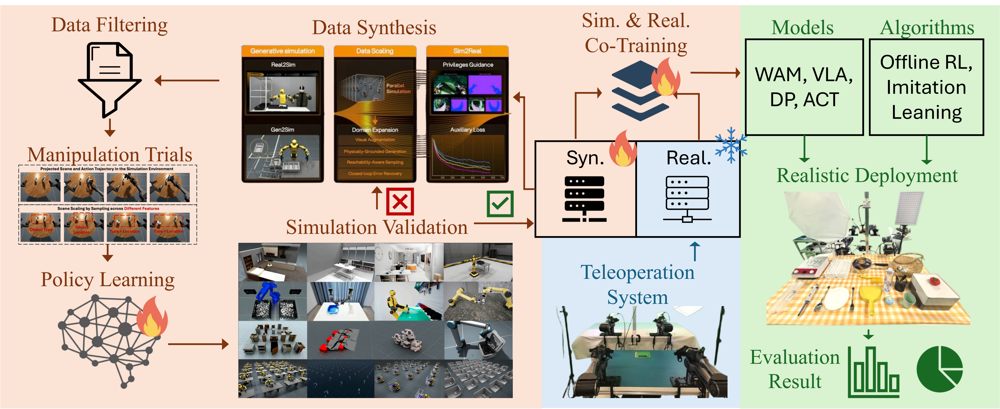

# Robosync_entry

RoboSynChallenge preliminary entry prepared by Adarsh Baburaj. This repository reuses official pretrained policies and selects a policy per task from published reference results. No new training is claimed.

**Preparation status:** all ten public checkpoint revisions and command routes verified. CPU model smoke tests are in progress. Linux NVIDIA simulation and official held-out evaluation have not run. The competition submission is pending account registration and organizer approval.

## Reproduce

Use [submission/REPRODUCE.txt](submission/REPRODUCE.txt) for the simulator and separate policy environments. The checkpoint manifest is [submission/selected_checkpoints.json](submission/selected_checkpoints.json).

```bash
python3 submission/run_selected.py download all
python3 submission/run_selected.py run click_bell --episodes 1
```

Run one task at a time in its official policy environment. Checkpoint weights stay in the official public Hugging Face repositories and are not committed here.

## Selected released policies

| Task | Policy | Published reference success | Pinned checkpoint |
| --- | --- | ---: | --- |
| click_bell | dp | 51% | [Hugging Face](https://huggingface.co/RoboSynChallenge/DP_sim_click_bell/tree/fb8c9551e0fade7c4888a926ab577b85f0684da1) |
| table_rearrangement | smolvla | 82% | [Hugging Face](https://huggingface.co/RoboSynChallenge/SmolVLA_sim_table_rearrangement/tree/913b29a7136876108a330aead1855309f985cbd8) |
| water_pouring | act | 72% | [Hugging Face](https://huggingface.co/RoboSynChallenge/ACT_sim_water_pouring/tree/0bf0fcfc931a69c52871385f28068fcf873cf07a) |
| handle_basket | smolvla | 40% | [Hugging Face](https://huggingface.co/RoboSynChallenge/SmolVLA_sim_handle_basket/tree/0de9a93f124bd4ebe2fbd0d572ce3133806b82a9) |
| items_handover | smolvla | 30% | [Hugging Face](https://huggingface.co/RoboSynChallenge/SmolVLA_sim_items_handover/tree/fabe9462853965228e90e34bd517aa4e43bad323) |
| drawer_open_place | smolvla | 62% | [Hugging Face](https://huggingface.co/RoboSynChallenge/SmolVLA_sim_drawer_open_place/tree/c0088d84a568f93fb4401aabafcc41cf643efcdd) |
| mixer_operating | act | 77% | [Hugging Face](https://huggingface.co/RoboSynChallenge/ACT_sim_mixer_operating/tree/0f12c53a2a6e093ae5e1e28f20480296b45fdf2b) |
| item_assembly | act | 64% | [Hugging Face](https://huggingface.co/RoboSynChallenge/ACT_sim_item_assembly/tree/58955958519157176712a1eff319018d78177ddb) |
| manipulate_pipette | act | 61% | [Hugging Face](https://huggingface.co/RoboSynChallenge/ACT_sim_manipulate_pipette/tree/ca013b2e202d594bf347530c61c3ba28c06d1bc2) |
| sample_loading | smolvla | 6% | [Hugging Face](https://huggingface.co/RoboSynChallenge/SmolVLA_sim_sample_loading/tree/2a4f41ab3be8e5f544c890d6054bc8de3be5c53b) |

The arithmetic mean of these published per-task success rates is **54.5%**, compared with **45.3%** for the official all-ACT reference. The selected published scores average **46.62**. These are source-reference comparisons, not results from a new evaluation of this entry. Held-out results and reproduction runs can differ. See the [official leaderboard](https://robosyn-bench.net/#/leaderboard).

## Credits

- [EDEM-AI/RoboSynChallenge](https://github.com/EDEM-AI/RoboSynChallenge) — official evaluation adapters, task environments, and released ACT, Diffusion Policy, and SmolVLA simulation checkpoints. Source snapshot: `8818c82df5fa2522809b8105e7018950dcc9a9a8`.
- Upstream Apache-2.0 source license is preserved in [LICENSE](LICENSE). Checkpoints retain their upstream provenance; code licensing is not asserted to be a separate weight license.

<details>
<summary>Upstream project documentation</summary>

<div align="center">
<h1>RoboSynChallenge: Mastering Real-World Dexterity via Generalizing Synthesized Manipulation Skills</h1>

<h2 align="center"> 👉<a href="https://edem-ai.github.io/robosynchallenge.github.io/">Webpage</a> | <a href="https://edem-ai.github.io/RoboSynChallenge/html/">Document</a> | <a href="">Paper</a> | <a href="https://edem-ai.github.io/robosynchallenge.github.io/#/leaderboard">Leaderboard</a></h2>



</div>

---

# Contents

- [Contents](#contents)
- [Installtion](#installtion)
- [Datasets](#datasets)
- [Training and Evaluation](#training-and-evaluation)
- [Released Checkpoint Results](#released-checkpoint-results)
- [LeaderBoard](#leaderboard)

# Installtion
Based on the [**EmbodiChain**](https://dexforce.github.io/EmbodiChain/main/quick_start/install.html), we offer both `docker` and `local` installation methods. For detailed installation instructions, please refer to [**Installation Document**](https://edem-ai.github.io/RoboSynChallenge/html/getting_started/installation.html).

# Datasets
We provide 1,000 pre-collected trajectories per task as part of the open-source release **RoboSynChallenge** Dataset. The datasets hosted on HuggingFace are available at [here](https://edem-ai.github.io/robosynchallenge.github.io/#/data).

However, we still strongly recommend users to perform data collection themselves. For detailed data collection instructions, please refer to [**Data Collection Document**](https://edem-ai.github.io/RoboSynChallenge/html/tutorials/collect_data.html).


# Training and Evaluation
Currently, RoboSynChallenge integrates training and evaluation for <a href="https://github.com/Physical-Intelligence/openpi">PI0</a>, <a href="https://github.com/Physical-Intelligence/openpi">PI0.5</a>, and <a href="https://github.com/thu-ml/Motus">Motus</a>. Detailed procedures can be found in the documentation for the corresponding strategies: 👉<a href="https://edem-ai.github.io/RoboSynChallenge/html/tutorials/policy/index.html">Webpage</a>.
In addition, you can easily extend your own policys for training and evaluation by following the documentation 👉<a href="https://edem-ai.github.io/RoboSynChallenge/html/tutorials/policy/your_own_policy.html.html">Webpage</a>.

# Released Checkpoint Results

100-episode simulation evaluations for the released ACT and Diffusion Policy checkpoints are published in [`evaluation_results`](evaluation_results/README.md). The machine-readable result file pins success rate, action steps, millisecond inference time, Hugging Face checkpoint revisions, and the `random` protocol configuration.

# LeaderBoard
The full leaderboard and setting can be found in: https://edem-ai.github.io/robosynchallenge.github.io/#/leaderboard.


</details>
